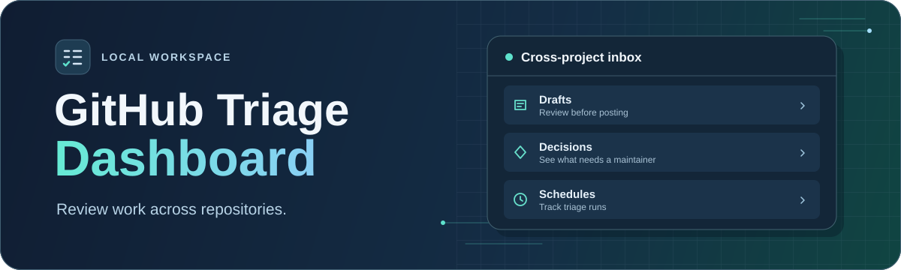

<p align="center"></p>

<h1 align="center">GitHub Triage Dashboard</h1>

<p align="center">Review issues, pull requests, and triage drafts across GitHub repositories.</p>

<p align="center"></p>

The dashboard runs on your computer. Its Inbox brings together drafts awaiting review, maintainer decisions, and failed or missed triage runs. Codex or Claude Code can prepare drafts for you to review before posting.

## Quickstart

Install Python 3.11 or newer, Git, and the GitHub CLI. Then run:

```sh
git clone https://github.com/neusse/Github-Triage-Dashboard.git
cd Github-Triage-Dashboard
gh auth login
python triage.py serve
```

Open [the local dashboard](http://127.0.0.1:8765) and select **Projects → Add repository**. Enter `owner/repo` and save. To run agent jobs, install and sign in to Codex or Claude Code and select it under **Default agent**. Codex is the default.

## [Documentation](docs/README.md)

- [Getting started](docs/getting-started.md) for setup and your first draft.
- [Project configuration](docs/configuration.md) for labels, review rules, merge settings, and agents.
- [Workflow guide](docs/workflows.md) for issues, PRs, drafts, and the Inbox.
- [Scheduled triage](docs/scheduled-triage.md) for enabling repeat runs and reviewing their results.
- [Development and CLI reference](docs/development.md) for commands, storage, and tests.

## License

The dashboard is licensed under the [BSD 3-Clause License](LICENSE). Bundled libraries carry their own [third-party notices](THIRD_PARTY_NOTICES.md).
